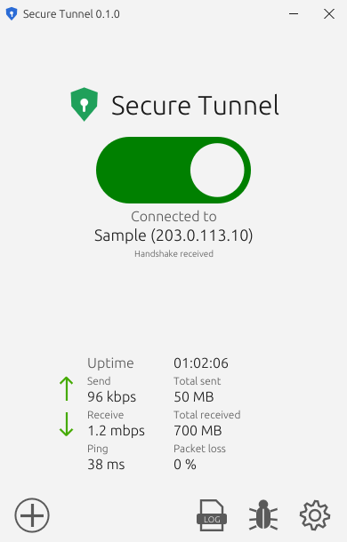

# Secure Tunnel

A VPN client for WireGuard and AmneziaWG profiles on Windows, macOS, Linux and Android. It can disguise its traffic to get through networks that use deep packet inspection (DPI) to block VPNs.


[](LICENSE)


<picture>
  <source media="(prefers-color-scheme: dark)" srcset="docs/images/main-dark.png">
  
</picture>

## Features

- Imports standard WireGuard `.conf` files, including AmneziaWG settings: junk packets (Jc, Jmin, Jmax, Jd), S1–S4 padding, H1–H4 headers and I1–I5 packets.
- Can make the first packets of a session look like QUIC, DNS, SIP or STUN traffic.
- Can send the tunnel's UDP traffic through a SOCKS5 proxy, with an optional username and password.
- Has a kill switch that uses the system firewall to block anything outside the tunnel.
- Lets you pick which apps use the tunnel (Linux, macOS, Android and Windows x64).
- Lives in the tray, with light and dark themes, encrypted profiles and an option to connect at startup.

The tunnel engine is built in ([boringtun](https://github.com/cloudflare/boringtun)), so you don't need to install WireGuard separately.

**Does not:** run a VPN server, sell or provide VPN service, or include any server profiles. You need a profile from your own server or provider.

> [!NOTE]
> Tested against a live WireGuard server on Windows, macOS and Android, including the Windows kill switch after a simulated crash. The Linux packages are built and start on Ubuntu, but haven't been tried against a live server yet. [FEATURE-PARITY.md](FEATURE-PARITY.md) has the status for each platform.

## Requirements

| Platform | Supported | Notes |
|---|---|---|
| Windows | 10/11, x64 and ARM64 | Uses the bundled Wintun driver. Per-app routing is x64 only (WinDivert). |
| macOS | 15 or later, Apple silicon and Intel | Per-app routing needs the network extension approved in System Settings. |
| Linux | x64 and ARM64, glibc 2.31 or later | Needs `nftables` and `iproute2`. |
| Android | 8.0 or later | Uses Android's VPN service. |
| iOS | Not supported | See [Why there's no iPhone app](#why-theres-no-iphone-app). |

Connecting needs administrator (or root) rights on desktop systems, because the app creates a network adapter and firewall rules.

### Why there's no iPhone app

Apple's App Store rules (guideline 5.4) only accept VPN apps from developers enrolled as an organization, and this project isn't. Outside the App Store, iOS gives few options for a VPN. A free Apple ID can't sign an app that uses Apple's VPN extension, so sideloading tools like AltStore and SideStore won't work. Ad hoc builds would need every iPhone registered with the developer ahead of time. The tunnel code in `mobile/core` does compile for iOS, so an app could follow if this changes.

## Install

Download the build for your system from the [Releases](../../releases) page.

| System | File | Notes |
|---|---|---|
| Windows x64 or ARM64 | `.msi` | Installer with a Start menu entry. The plain `.exe` runs without installing. |
| macOS (Apple silicon and Intel) | `.dmg` or `.pkg` | One universal app, signed and notarized. Drag it to Applications from the `.dmg`, or let the `.pkg` install it. |
| Debian, Ubuntu | `.deb` | x64 and ARM64 |
| Fedora, RHEL, openSUSE | `.rpm` | x64 and ARM64 |
| Arch | `.pkg.tar.zst` | x64 and ARM64 |
| Any Linux, x64 | `.AppImage` | Make it executable and run it. |
| Any Linux with Flatpak, x64 | `.flatpak` | Install with `flatpak install ./<FILE>.flatpak`. The tunnel needs root, so its helper runs outside the sandbox through `pkexec`. |
| Other Linux | `.tar.gz` | Includes `install.sh`. |
| Android | `.apk` | Android 8.0 or later |

Each release also has a `SHA256SUMS` file for checking downloads.

On Debian or Ubuntu, for example (afterwards, Secure Tunnel shows up in your app menu):

```bash
sudo apt install ./secure-tunnel_<VERSION>-1_amd64.deb
```

## Quick start

1. Start Secure Tunnel.
2. Click **+** and choose a WireGuard `.conf` file, or paste a profile.
3. Flip the switch to connect. The main window shows the handshake, traffic and ping.

A minimal profile looks like this:

```ini
[Interface]
PrivateKey = <YOUR_PRIVATE_KEY>
Address = 192.168.100.2/32
DNS = 1.1.1.1

[Peer]
PublicKey = <SERVER_PUBLIC_KEY>
Endpoint = vpn.example.com:51820
AllowedIPs = 0.0.0.0/0, ::/0
```

<details>
<summary>AmneziaWG and masking settings</summary>

Add AmneziaWG values to the `[Interface]` section to match your server, for example:

```ini
Jc = 4
Jmin = 40
Jmax = 70
S1 = 0
S2 = 0
H1 = 1
H2 = 2
H3 = 3
H4 = 4
```

Masking (QUIC, DNS, SIP or STUN look-alike packets) and the SOCKS5 proxy are set per profile in the profile editor. [MECHANICS.md](MECHANICS.md) documents every setting and its limits.

</details>

## Build from source

You need Rust 1.85 or later.

```bash
cargo build --release
cargo test
```

A Windows build downloads the Wintun and WinDivert drivers from their official releases the first time and checks them against pinned SHA-256 hashes. That step needs Python 3 and internet access. You can also run it yourself with `python -I scripts/fetch_vendor.py`.

<details>
<summary>Other targets</summary>

| Target | How |
|---|---|
| Linux | `cargo zigbuild --release --target x86_64-unknown-linux-gnu.2.31` (and `aarch64-…`), then `python -I packaging/linux/build-packages.py` for `.deb`, `.rpm`, Arch and `.tar.gz` (needs `cargo-deb` and `cargo-generate-rpm`). On Linux, `packaging/linux/build-appimage.sh` makes the AppImage; `.github/workflows/linux-packages.yml` shows the Flatpak build. |
| Windows | `python -I packaging/windows/build-windows.py` builds the `.exe` and `.msi` for x64 and ARM64. It needs WiX 5 and, for ARM64, llvm-mingw; the script's header lists the setup. |
| macOS | `macos/build-mac.sh` in Terminal on a Mac with Xcode makes the universal `.dmg` and `.pkg`. Set your own team ID and bundle ID in the Xcode project first; the script's header lists the certificates and notarization setup it needs. |
| Android | `python packaging/android/build-android.py --debug-key` builds the Rust core with `cargo ndk` and the APK with Gradle. Without your own key (`ST_KEYSTORE`), use `--debug-key`; the script's header explains signing. |

</details>

## Help and contributing

Report bugs and ask questions in [Issues](../../issues). This repository is published from a separate development repository, so pull requests can't be merged directly, but fixes sent in issues or pull requests get copied over by hand and ship in the next release.

## Changelog

See [CHANGELOG.md](CHANGELOG.md).

## License

[GPL-3.0-or-later](LICENSE). The bundled Wintun and WinDivert drivers keep their own licenses; see [THIRD_PARTY.md](THIRD_PARTY.md).

## Acknowledgements

Secure Tunnel is an independent, clean-room reimplementation of the feature set of WireSock Secure Connect, written from scratch in Rust for more platforms. It isn't affiliated with or endorsed by the WireSock project. It builds on [boringtun](https://github.com/cloudflare/boringtun), [tun-rs](https://github.com/tun-rs/tun-rs), [egui](https://github.com/emilk/egui), [Wintun](https://www.wintun.net/) and [WinDivert](https://reqrypt.org/windivert.html).
